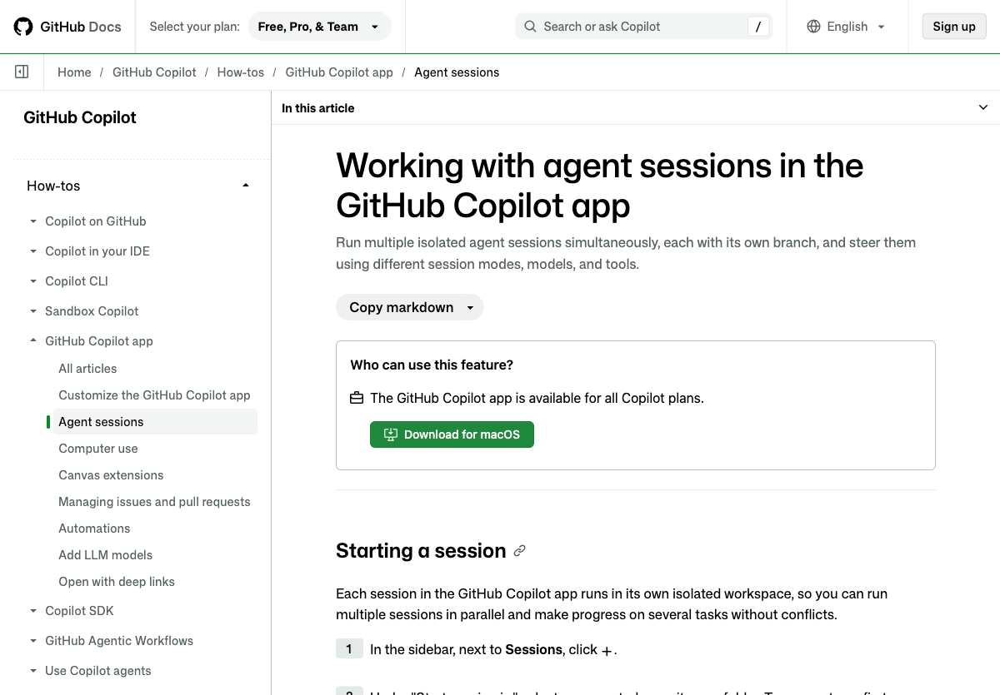

# Lab 1 — Build the ordering app and choose a model

[简体中文](https://kinfey.github.io/aigenius-ghc-app-hol/lab1/zh.html) · [Workshop home](../) · [Next: Lab 2](../lab2/)

**Goal:** Build a local full-stack ordering prototype that works on desktop, tablet and phone, then compare Auto with an optional, separately launched Decision Router. Allow 90 minutes.


*Reference: [GitHub's session documentation](https://docs.github.com/en/copilot/how-tos/github-copilot-app/agent-sessions). Actual controls may differ by app version.*

## 1. Prepare a workspace

1. Install Git, Node.js 22.16+, Edge and [GitHub Copilot App](https://github.com/features/copilot/copilot-app). Sign in and verify your Copilot entitlement.
2. Create an empty local folder named `ordering-workshop`. In Copilot App choose **Sessions → New → Open local folder**, select that folder, and trust it only after checking its contents.
3. Choose **Plan** mode below the composer, then select **Auto** in the model picker. Auto chooses an available model for each task; the picker shows the model used for responses. The UI, models and billing depend on account and policy.
4. Ask Copilot:

   > Plan a small ordering application with a React/Vite TypeScript front end and a Node.js TypeScript API. Use a single local workspace. Use mock products and prices, a cart and simulated checkout. Support phone, tablet and desktop; include keyboard accessibility, loading, empty and error states. Suggest a test plan and exact run commands. Do not connect real services or put secrets in frontend code.

5. Review the plan before approving it. Ask for changes if it does not separate browser UI from the server. In **Interactive** mode ask it to implement the approved plan, run its tests, and report the exact commands and ports. Review file changes and approve tool calls individually; do not use blanket approval.
6. If installing packages, use your permitted npm registry. For this workshop use `https://packagefeedproxy.microsoft.io/npm/`; ask Copilot to configure the project accordingly and install dependencies. Do not paste credentials into chat.

## 2. Run and inspect the app

1. Ask Copilot to start the API and front-end development servers using the commands it created. If offered a browser canvas, open it; also open the local front-end URL in Edge. Keep servers running only while working.
2. In Edge open DevTools (`F12` or `Cmd+Option+I`) and toggle device emulation. Check **390 × 844**, **768 × 1024**, and **1440 × 900**. Add and remove an item, inspect the cart and complete a **simulated** checkout at each width. There should be no horizontal overflow or inaccessible controls.
3. Stop the API temporarily and refresh or perform a request: the UI should show an error and offer a retry rather than display invented data. Restart it afterwards.
4. Ask Copilot to run the generated test suite and fix regressions. Record exact commands and results in your own notes; do not commit screenshots of personal information.

## 3. Practice token-aware collaboration

Copilot App combines an agent, workspace, tools, modes and a model picker: the agent can inspect files, edit code, run tests and show results in a canvas; you remain responsible for reviewing its actions. **Auto** is not the same as the router below.

1. Start a fresh session in the same project and select **Auto**. Give a narrow request, such as “Add an empty-cart test; change only the relevant component and test.” Refer to files with `@` where helpful instead of pasting the whole repository.
2. Ask the agent to report the model it used and available usage information. Record task, selected model, elapsed time, test outcome and any available usage/charges. A usage display is not necessarily a final invoice.
3. Repeat with a harder task, such as “Trace a failed API call through UI and server, propose a fix and regression test.” Observe whether Auto changes model. Availability and routing are not deterministic; do not infer model quality or pricing from its name alone.
4. Reduce waste: make the acceptance criteria specific, request a plan before a broad edit, use focused tests first, avoid repeatedly resending large files, and start a fresh session when context becomes stale. Larger context, tool calls, retries, model choice and output length can all affect costs. Refer to [Copilot billing](https://docs.github.com/en/copilot/reference/copilot-billing/models-and-pricing).

## 4. Optional: Microsoft-Decision-1 and Decision Router

**Important:** The private router's documented native integration is an **experimental Copilot CLI** extension, not a verified model-picker integration for Copilot App. These steps run in a separate terminal session against the same project; continue the rest of the workshop in the App. Do not claim that a routed CLI turn automatically configures or routes App turns. Router access may be restricted; if unavailable, continue with Auto.

1. In [Microsoft Foundry](https://ai.azure.com/), open your own project → **Model catalog** → **Microsoft-Decision-1** → **Deploy**. Name the deployment `Decision-1` or record your chosen name. Availability, capacity, permissions and pricing vary. Copy your own resource endpoint and key from the deployment page. Follow the [official instructions](https://learn.microsoft.com/en-us/azure/foundry/foundry-models/how-to/use-foundry-models-microsoft-decision).
2. With access to the private repository, clone it **outside** the application folder. If access is denied, ask its owner; do not copy private source into this public tutorial. In a terminal:

   ```bash
   gh repo clone kinfey/decision-ghc-router
   cd decision-ghc-router
   npm install --registry=https://packagefeedproxy.microsoft.io/npm/
   cp -n .env.example .env
   chmod 600 .env
   ```

3. Privately edit the router's `.env`, without posting it in chat or screenshots:

   ```dotenv
   JEV_PROVIDER=azure
   AZURE_DECISION_ENDPOINT=https://<your-resource>.services.ai.azure.com/providers/microsoft/v1/systemone
   AZURE_DECISION_API_KEY=<your-own-key>
   AZURE_DECISION_MODEL=Decision-1
   JEV_FALLBACK_CHEAPEST=0
   ```

   Use your actual deployment name if different. Do not commit `.env`; do not ask Copilot to read it. The classifier receives the task text and candidate model metadata, so keep secrets and personal information out of prompts.
4. Install the user extension and start the documented experimental CLI:

   ```bash
   npm run install:router
   npm run router
   ```

   Accept only the requested workspace trust and `user:decision-router` hook permissions after review. In the CLI choose `/model` → **Decision Router**, or `/model decision/router`. Submit a non-sensitive test task and look for the reported execution model and estimate. Use `/model` to select a native model to bypass the router.
5. To work on the ordering project in a new CLI session, first install as above, change to your project, then start `COPILOT_ALLOW_GET_PROVIDER_ENDPOINT=true copilot --experimental` and select the router. Keep the cloned router directory in place. To remove the extension later, run `npm run uninstall:router` in that directory and restart the CLI.
6. Record the task, selected model, estimate and result alongside the Auto experiment. Decision-1 **classifies**; a Copilot model still performs the task. Azure classification and Copilot execution are separately billed. The router estimate omits retries, subsequent tool rounds and other charges; its custom-provider display and CLI usage counters are not a reliable billing cap. Consult GitHub and Azure billing.

If the router does not appear, verify Node version, private repo access, CLI experimental mode, hook permission and the [router README](https://github.com/kinfey/decision-ghc-router). Missing credentials, network errors or low confidence fail explicitly; do not work around the error by sharing keys.

## Evidence and completion

Capture **your own** redacted screenshots: (1) Copilot App showing the plan and Auto picker; (2) Edge at each of the three viewport sizes; (3) optional Foundry deployment details with endpoint/key hidden and the CLI router selection. The reference image above is not a substitute for these screenshots.

You are done when the app works at all three sizes, the UI handles an API outage, tests pass, and checkout is simulated. Keep the project for [Lab 2](../lab2/).
