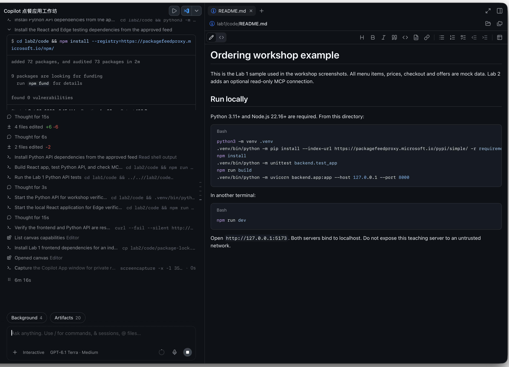
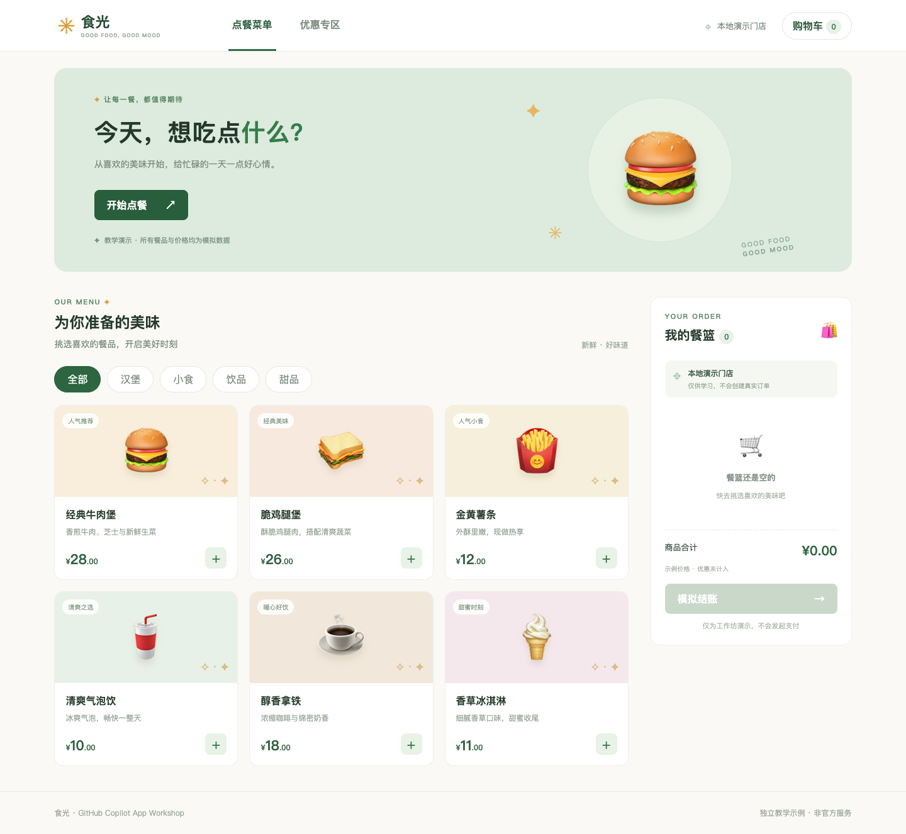
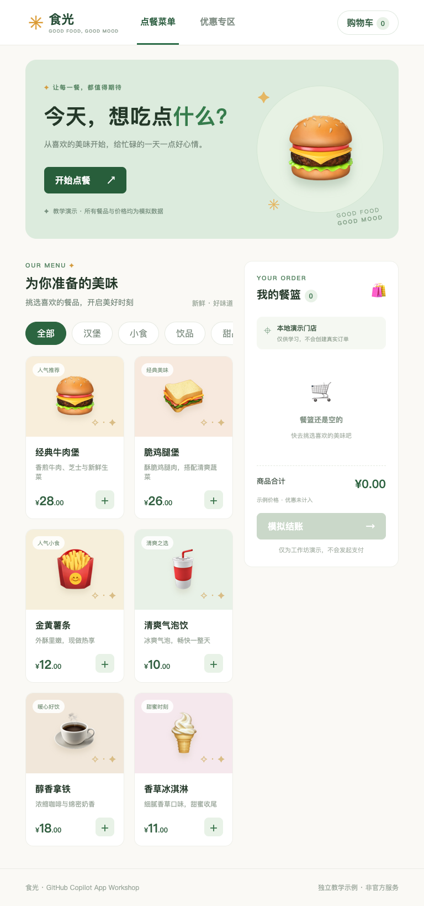
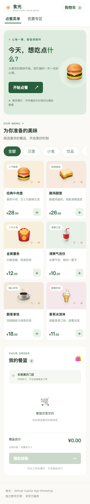
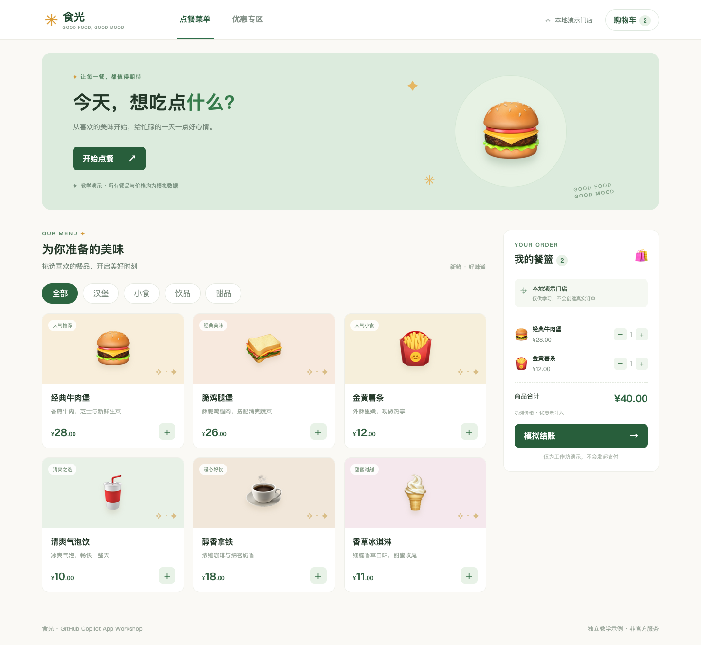
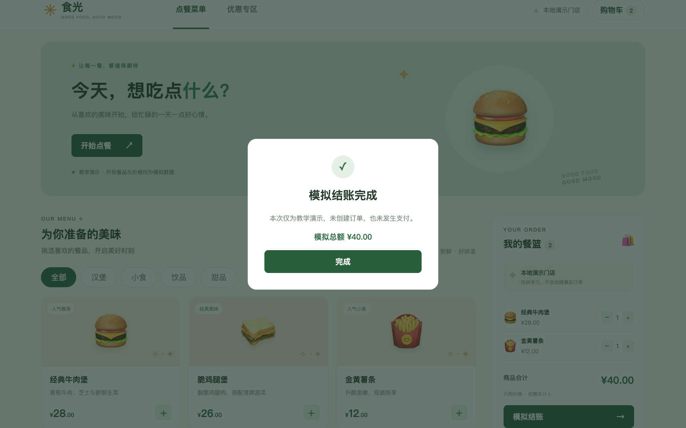
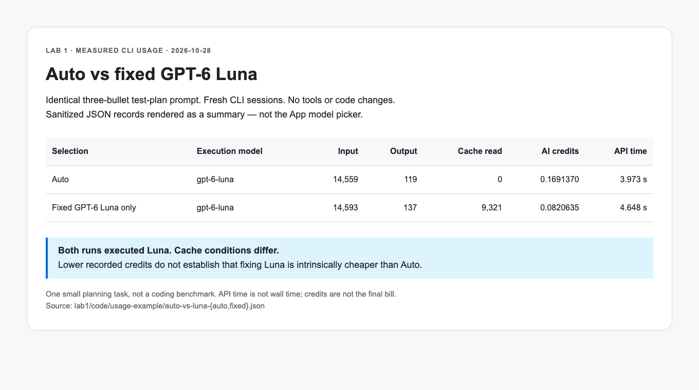
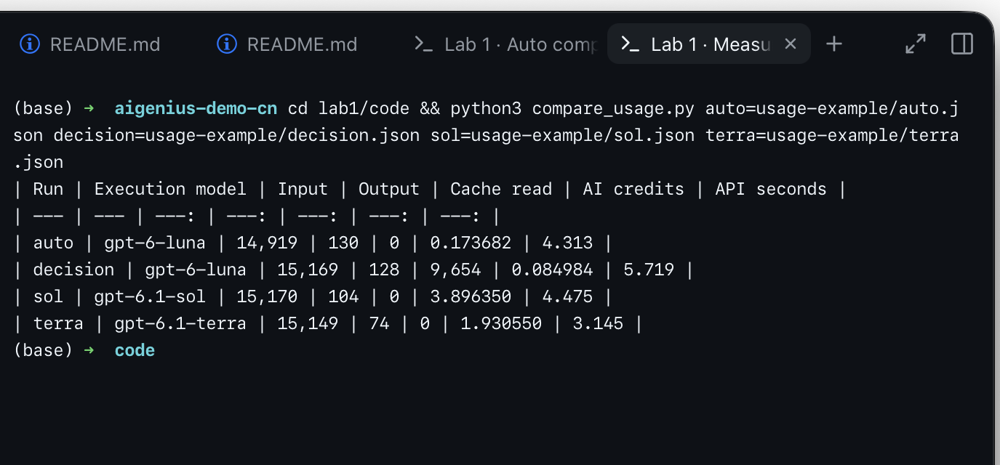

# Lab 1 — Build the ordering app and choose a model

[简体中文](https://kinfey.github.io/aigenius-ghc-app-hol/lab1/zh.html) · [繁體中文](https://kinfey.github.io/aigenius-ghc-app-hol/lab1/traditional.html) · [Workshop home](../) · [Next: Lab 2](../lab2/)

**Goal:** Build and inspect a local full-stack ordering prototype across desktop, tablet and phone, and compare **Auto versus using only GPT-6 Luna (`gpt-6-luna`)** on the same small task. Allow **20 minutes** of the **60-minute workshop** (20 + 15 + 25).

**Timed route:** 0–3 min inspect the preinstalled starter; 3–12 min plan and implement one bounded UI/API improvement with Auto; 12–17 min inspect responsive layouts, checkout and a focused test; 17–20 min run the same concise planning prompt with Auto and fixed GPT-6 Luna and compare the recorded results. Installation and dependency restoration are pre-class work. Use [`lab1/code`](https://github.com/kinfey/aigenius-ghc-app-hol/tree/main/lab1/code) as the prepared baseline if generation takes longer. The detailed from-scratch instructions remain reference material; repeated benchmarks and section 4's Decision Router/Azure setup are **after-class extensions**, not part of these 20 minutes.


*Reference: [GitHub's session documentation](https://docs.github.com/en/copilot/how-tos/github-copilot-app/agent-sessions). Actual controls may differ by app version.*

## 1. Prepare a workspace

1. Install Git, Node.js 22.16+, Edge and [GitHub Copilot App](https://github.com/features/copilot/copilot-app). Sign in and verify your Copilot entitlement.
2. Before class, create a local folder named `ordering-workshop` and run `git init` inside it; prepare the starter there if using the timed route. Git supports version control and the optional after-class SDK extension; Lab 3's existing Browser canvas does not require authoring such an extension. Do not nest the learner workspace inside this tutorial repository. In Copilot App choose **Sessions → New → Open local folder**, select that folder, and trust it only after checking its contents.
3. Choose **Plan** mode below the composer, then select **Auto** in the model picker. Auto chooses an available model for each task; the picker shows the model used for responses. The UI, models and billing depend on account and policy.
4. Ask Copilot:

   > Plan a small ordering application with a React/Vite TypeScript front end and a Python FastAPI backend. Use a single local workspace. Use mock products and prices, a cart and simulated checkout. Support phone, tablet and desktop; include keyboard accessibility, loading, empty and error states. Suggest a test plan and exact run commands. Do not connect real services or put secrets in frontend code.

5. Review the plan before approving it. Ask for changes if it does not separate browser UI from the server. In **Interactive** mode ask it to implement the approved plan, run its tests, and report the exact commands and ports. Review file changes and approve tool calls individually; do not use blanket approval.
6. If installing packages, use `https://packagefeedproxy.microsoft.io/npm/` for npm and `https://packagefeedproxy.microsoft.io/pypi/simple/` for PyPI. Ask Copilot to configure the project accordingly and install dependencies. Do not paste credentials into chat.

The completed example is in [`lab1/code`](https://github.com/kinfey/aigenius-ghc-app-hol/tree/main/lab1/code), with installation and run commands in its README. This is a real Copilot App capture during implementation; the sidebar was cropped to protect unrelated sessions.



## 2. Run and inspect the app

1. Ask Copilot to start the API and front-end development servers using the commands it created. If offered a browser canvas, open it; also open the local front-end URL in Edge. Keep servers running only while working.
2. In Edge open DevTools (`F12` or `Cmd+Option+I`) and toggle device emulation. Check **390 × 844**, **768 × 1024**, and **1440 × 900**. Add and remove an item, inspect the cart and complete a **simulated** checkout at each width. There should be no horizontal overflow or inaccessible controls.
3. Stop the API temporarily and refresh or perform a request: the UI should show an error and offer a retry rather than display invented data. Restart it afterwards.
4. Ask Copilot to run the generated test suite and fix regressions. Record exact commands and results in your own notes; do not commit screenshots of personal information.

The following captures were made by running the Lab 1 Python backend and React app in Microsoft Edge. They show the desktop, tablet and phone layouts:





After adding two mock items, the cart and simulated checkout looked like this:




## 3. Compare Auto with using only GPT-6 Luna

Copilot App combines an agent, workspace, tools, modes and a model picker: the agent can inspect files, edit code, run tests and show results in a canvas; you remain responsible for reviewing its actions. **Auto** is not the same as the router below.

1. In a fresh App session in the same project select **Auto**. Submit the short, non-sensitive planning prompt below without tools or code changes.
2. Create another fresh session against the unchanged baseline and select **GPT-6 Luna** in the App model picker, not Auto or Decision Router. Submit the identical prompt, then verify the execution model is `gpt-6-luna`. Do not compare a second session that inherits the first answer. If this model is not offered for your account, record “unavailable”; do not silently substitute another model.
3. Record each response, actual execution model, available input/output/cache usage, API time and credits. Check the suggestions against the actual sample and its tests. The App and standalone CLI are separate execution surfaces; the CLI commands below reproduce the CLI measurements, not an App picker action. More difficult tasks, repeated trials and the router comparison are after-class work.
4. Reduce waste: make the acceptance criteria specific, request a plan before a broad edit, use focused tests first, avoid repeatedly resending large files, and start a fresh session when context becomes stale. Larger context, tool calls, retries, model choice and output length can all affect costs. Refer to [Copilot billing](https://docs.github.com/en/copilot/reference/copilot-billing/models-and-pricing).

### New measured pair: Auto versus fixed GPT-6 Luna

On October 28, 2026, two fresh standalone CLI sessions ran this identical prompt in the same clean working directory, with custom instructions and built-in MCPs disabled. Neither session used tools or changed code. The fixed run used `--model gpt-6-luna` directly, without a Decision Router or Azure classifier:

> In three concise bullets, propose a test plan for a responsive ordering app that includes menu, cart, and simulated checkout. Do not use tools.

| Selection | Actual execution model | Input tokens | Output tokens | Cache-read tokens | Copilot AI credits | Model API time |
| --- | --- | ---: | ---: | ---: | ---: | ---: |
| Auto | GPT-6 Luna | 14,559 | 119 | 0 | 0.1691370 | 3.973 s |
| Fixed GPT-6 Luna only | GPT-6 Luna | 14,593 | 137 | 9,321 | 0.0820635 | 4.648 s |


*Rendered summary of actual sanitized CLI usage JSON, not a screenshot of the App model picker. No session IDs, prompts containing private data or credentials are included.*

**What this shows:** Auto selected Luna for this prompt, while the other run explicitly fixed Luna. Both proposed responsive layout, cart and checkout checks; fixed Luna explicitly mentioned avoiding real payment. Both also suggested validating checkout details, but this sample checkout is a confirmation dialog without an input form, so that advice needs correction. This is not a quality win or a coding benchmark.

The fixed run read 9,321 cached tokens while Auto read none. Its lower recorded credits **do not establish that fixing Luna is intrinsically cheaper than Auto**; API time is not end-to-end wall time, and usage credits are not the final bill. These two runs are separate from the older four-way sample below; do not combine them into a controlled ranking.

Reproduce without installing the optional router:

```bash
TASK='In three concise bullets, propose a test plan for a responsive ordering app that includes menu, cart, and simulated checkout. Do not use tools.'
copilot --model auto --no-custom-instructions --no-auto-update --disable-builtin-mcps --disable-mcp-server mcd-mcp --no-ask-user -p "$TASK" --usage-output-file auto-usage.json
copilot --model gpt-6-luna --no-custom-instructions --no-auto-update --disable-builtin-mcps --disable-mcp-server mcd-mcp --no-ask-user -p "$TASK" --usage-output-file luna-usage.json
```

Keep raw records private. From `lab1/code`, inspect the included sanitized pair with:

```bash
python3 compare_usage.py Auto=usage-example/auto-vs-luna-auto.json FixedLuna=usage-example/auto-vs-luna-fixed.json
```

### Historical optional comparison: Auto, Decision Router, Sol and Terra

The following is a real one-run demonstration from October 28, 2026, using the **same non-sensitive prompt**, working directory, `--no-custom-instructions`, and a fresh CLI session for each run. The Decision row used the private router's **startup routing** and the Azure classifier described in the next section; it is not an App model-picker integration. The prompt was:

> In three concise bullets, propose a test plan for a responsive ordering app that includes menu, cart, and simulated checkout. Do not use tools.

| Choice | Actual execution model | Input tokens | Output tokens | Cache-read tokens | Copilot AI credits | Credit equivalent (USD) | Model API time |
| --- | --- | ---: | ---: | ---: | ---: | ---: | ---: |
| Auto | GPT-6 Luna | 14,919 | 130 | 0 | 0.173682 | $0.001737 | 4.313 s |
| Decision Router | GPT-6 Luna | 15,169 | 128 | 9,654 | 0.084984 | $0.000850 | 5.719 s |
| GPT-6.1 Sol | GPT-6.1 Sol | 15,170 | 104 | 0 | 3.896350 | $0.038964 | 4.475 s |
| GPT-6.1 Terra | GPT-6.1 Terra | 15,149 | 74 | 0 | 1.930550 | $0.019306 | 3.145 s |



**Interpretation:** This is one small test-plan request, not a benchmark. Input includes agent context; cache-read tokens are part of input, not additional tokens. The Decision run reused 9,654 cached input tokens while the other runs did not, so its lower observed Copilot usage **cannot be attributed solely to routing**. The API time is not end-to-end wall time and excludes classifier time. Both Auto and Decision selected Luna in this run; that may change. Sol and Terra may be useful for deeper analysis or more complex implementation, but validate quality on your own tasks rather than assuming a winner.

Credits above are reported by CLI usage records. The USD column converts credits at the published reference rate of **1 credit = $0.01**; it is **not the actual amount charged**, which depends on your plan, allowances and billing. The Decision Router's Azure classifier tokens and Azure charges are **not included** and were not reported by the router; check Azure usage/billing separately. Its printed `$0.002000` was a **pre-execution estimate** based on 10,000 input and 2,000 output tokens, not the measured bill. One initial router attempt timed out; the successful run shown here and any retry may incur separate Azure charges.

To reproduce, install and configure the optional router in section 4 first. From the same working directory run each command with the same prompt, and keep the resulting JSON files private:

```bash
TASK='In three concise bullets, propose a test plan for a responsive ordering app that includes menu, cart, and simulated checkout. Do not use tools.'
copilot --model auto --no-custom-instructions -p "$TASK" --usage-output-file auto-usage.json
copilot --model gpt-6.1-sol --no-custom-instructions -p "$TASK" --usage-output-file sol-usage.json
copilot --model gpt-6.1-terra --no-custom-instructions -p "$TASK" --usage-output-file terra-usage.json
```

In the router directory, use the same `TASK` and point `-C` to that same project. Replace both paths with your own:

```bash
npm start -- -C /path/to/ordering-workshop -p "$TASK" -- --no-custom-instructions --usage-output-file /path/to/decision-usage.json
```

`TASK` must be defined in this terminal too. The router's `-C` option selects the execution workspace; do not confuse it with the router's own directory. Compare each usage JSON's actual model, input, output, cached tokens and `totalNanoAiu` (divide by one billion for credits); `lab1/code/compare_usage.py` prints the table and `usage-example/` contains sanitized figures from the run above. Review generated plans against the actual code: for example, some of these plans suggest form validation even though the sample checkout has no form. Run repeated trials with comparable cache conditions and real acceptance tests before choosing a model.

## 4. After class, optional: Microsoft-Decision-1 and Decision Router

**Important:** The private router's documented native integration is an **experimental Copilot CLI** extension, not a verified model-picker integration for Copilot App. These steps run in a separate terminal session against the same project; continue the rest of the workshop in the App. Do not claim that a routed CLI turn automatically configures or routes App turns. Router access may be restricted; if unavailable, continue with Auto.

1. In [Microsoft Foundry](https://ai.azure.com/), open your own project → **Model catalog** → **Microsoft-Decision-1** → **Deploy**. Name the deployment `Decision-1` or record your chosen name. Availability, capacity, permissions and pricing vary. Copy your own resource endpoint and key from the deployment page. Follow the [official instructions](https://learn.microsoft.com/en-us/azure/foundry/foundry-models/how-to/use-foundry-models-microsoft-decision).
2. With access to the private repository, clone it **outside** the application folder. If access is denied, ask its owner; do not copy private source into this public tutorial. In a terminal:

   ```bash
   gh repo clone kinfey/decision-ghc-router
   cd decision-ghc-router
   npm install --registry=https://packagefeedproxy.microsoft.io/npm/
   cp -n .env.example .env
   chmod 600 .env
   ```

3. Privately edit the router's `.env`, without posting it in chat or screenshots:

   ```dotenv
   JEV_PROVIDER=azure
   AZURE_DECISION_ENDPOINT=https://<your-resource>.services.ai.azure.com/providers/microsoft/v1/systemone
   AZURE_DECISION_API_KEY=<your-own-key>
   AZURE_DECISION_MODEL=Decision-1
   JEV_FALLBACK_CHEAPEST=0
   ```

   Use your actual deployment name if different. Do not commit `.env`; do not ask Copilot to read it. The classifier receives the task text and candidate model metadata, so keep secrets and personal information out of prompts.
4. Install the user extension and start the documented experimental CLI:

   ```bash
   npm run install:router
   npm run router
   ```

   Accept only the requested workspace trust and `user:decision-router` hook permissions after review. In the CLI choose `/model` → **Decision Router**, or `/model decision/router`. Submit a non-sensitive test task and look for the reported execution model and estimate. Use `/model` to select a native model to bypass the router.
5. To work on the ordering project in a new CLI session, first install as above, change to your project, then start `COPILOT_ALLOW_GET_PROVIDER_ENDPOINT=true copilot --experimental` and select the router. Keep the cloned router directory in place. To remove the extension later, run `npm run uninstall:router` in that directory and restart the CLI.
6. Record the task, selected model, estimate and result alongside the Auto experiment. Decision-1 **classifies**; a Copilot model still performs the task. Azure classification and Copilot execution are separately billed. The router estimate omits retries, subsequent tool rounds and other charges; its custom-provider display and CLI usage counters are not a reliable billing cap. Consult GitHub and Azure billing.

If the router does not appear, verify Node version, private repo access, CLI experimental mode, hook permission and the [router README](https://github.com/kinfey/decision-ghc-router). Missing credentials, network errors or low confidence fail explicitly; do not work around the error by sharing keys.

## Evidence and completion

Capture **your own** redacted screenshots: (1) Copilot App showing the plan and the Auto/fixed Luna selections and responses; (2) Edge at each of the three viewport sizes; (3) optional Foundry deployment details with endpoint/key hidden and the CLI router selection. The reference images above are not substitutes for these screenshots.

You are done when the app works at all three sizes, the UI handles an API outage, tests pass, checkout is simulated, and the same-prompt Auto/fixed Luna comparison is recorded (or model unavailability is documented). Keep the project for [Lab 2](../lab2/).
