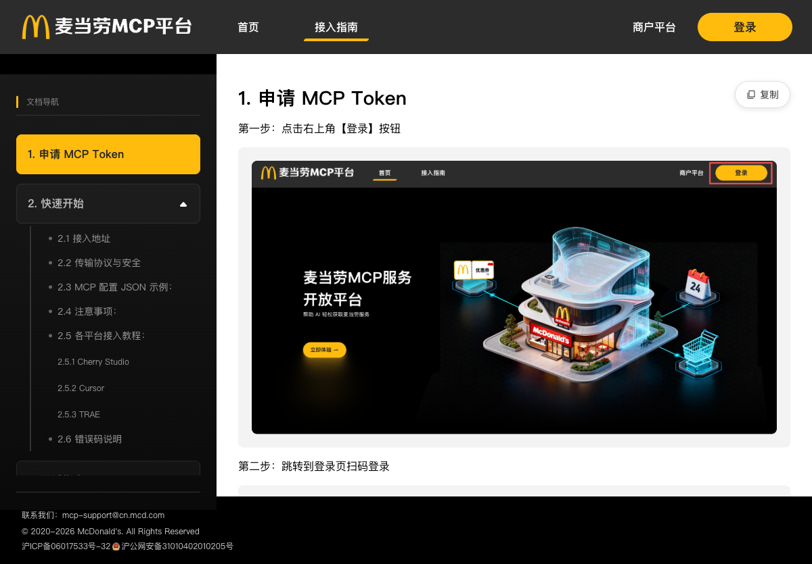
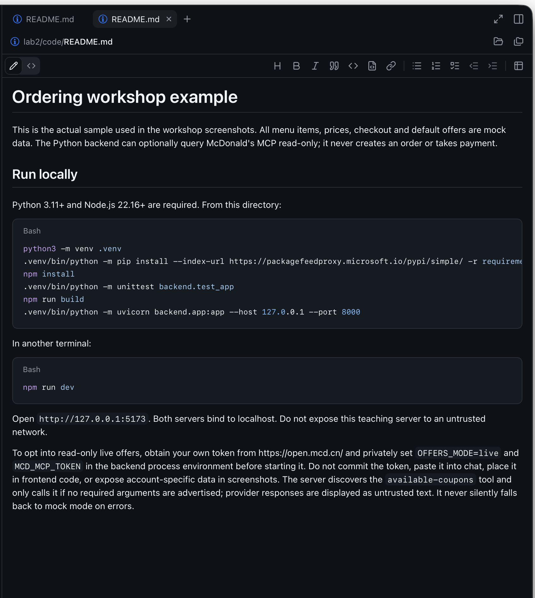
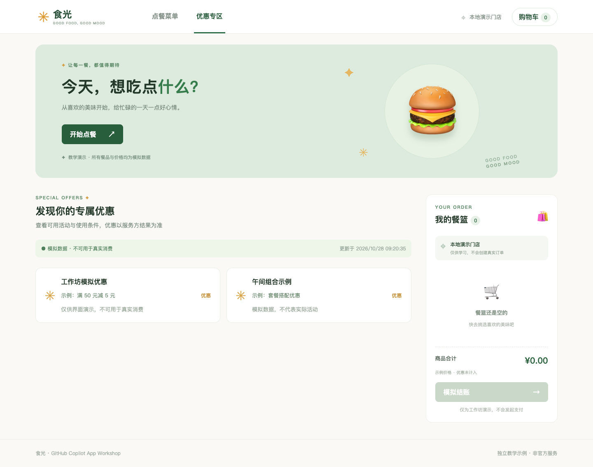
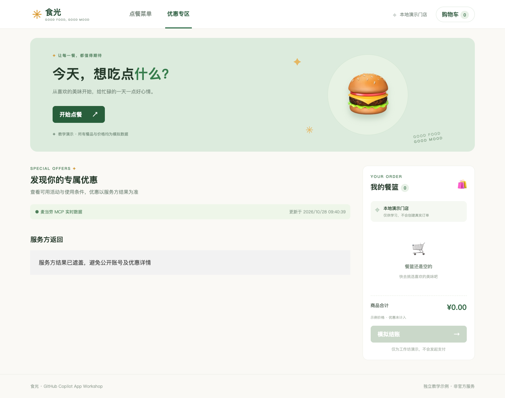

# 实验二：使用 MCP 查找麦当劳优惠

[English](https://kinfey.github.io/aigenius-ghc-app-hol/lab2/) · [繁體中文](https://kinfey.github.io/aigenius-ghc-app-hol/lab2/traditional.html) · [实验一](../lab1/zh.html) · [下一步：实验三](../lab3/zh.html)

**目标：**将 Copilot App 连接麦当劳中国 MCP 服务，查询优惠信息并检查预置只读优惠适配器。用时 **15 分钟**，属于 **60 分钟课程**的一部分（20 + 15 + 25）。

**限时路线：**0–3 分钟理解两个客户端的边界；3–8 分钟验证课前配置好的 MCP 连接并发现只读工具；8–12 分钟查询真实优惠、检查来源和条件；12–15 分钟查看预置适配器及一个失败状态。账户激活、同意条款、私下准备 Token 和安装依赖均在**课前**完成。第 4 节完整实现提示词作为参考/课后练习，限时课堂使用已提供的 [`lab2/code`](https://github.com/kinfey/aigenius-ghc-app-hol/tree/main/lab2/code)。

共享示例现在默认进入实验三的真实引导向导。如需查看原实验二菜单/优惠界面，显式打开 `http://127.0.0.1:5173/?demo=1`；其优惠接口由 `OFFERS_MODE` 控制（默认 `mock`，仅私下启用后为 `live`）。这不改变默认向导只使用真实服务的行为。

*参考：[麦当劳 MCP 文档](https://open.mcd.cn/mcp/doc)和[服务指南](https://github.com/M-China/mcd-mcp-server)。*

## 1. 理解连接边界

MCP 向 Agent 提供工具，但不会自动把工具提供给网页应用的后端。本实验有**两个独立客户端**：Copilot App 使用自己的 MCP 连接发现和辅助查询；应用服务器如启用实时模式，则使用独立的服务端连接和本地配置。浏览器绝不能获得 MCP Token。

该服务面向中国大陆地区。优惠、价格和适用门店因账号及时间而异。请遵守服务条款，仅使用自己的账号。不要在截图或提示词中公开真实券码、地址、订单详情或凭据。

## 2. 获取自己的 Token

1. 在 Edge 打开 [open.mcd.cn](https://open.mcd.cn/)，进入 MCP 页面，使用自己的账号登录并打开控制台。
2. 激活 MCP 服务，阅读并同意当前条款，获取个人 MCP Token。不要把它复制到对话、截图、源码、Git 或浏览器存储。泄露后应撤销或轮换。
3. 保留官方文档页面。服务器地址为 `https://mcp.mcd.cn`，使用 Streamable HTTP。请求头填写 `Authorization: Bearer <YOUR_MCP_TOKEN>`，即 Token 前必须加 `Bearer` 和一个空格。

## 3. 连接 Copilot App

1. 在 App 左侧选择 **Customize → MCP**，添加自定义远程服务器，命名为 `mcd-mcp`。选择 **HTTP / Streamable HTTP**，URL 填写 `https://mcp.mcd.cn`，并将 `Authorization` 请求头设为 `Bearer <YOUR_MCP_TOKEN>`。使用私密设置界面，不要写入仓库文件。如果当前版本提供 JSON 而非表单，请使用相同字段并私下填入 Token。
2. 保存并启用，在 **Customize → Installed** 查看服务器状态；必要时重启会话。如果安装项提示登录，在该服务器的 Installed 行或操作菜单中选择 **Sign in**。不要向项目添加含凭据的 `.mcp.json`。
3. 回到现有点餐会话，询问：

   > 检查 mcd-mcp 提供的工具。列出与优惠券相关的只读工具并解释所需参数。不要调用领券、创建订单或修改账户数据的工具。

4. 只批准必要的只读调用。如果服务器提供 `available-coupons` 和 `campaign-calendar`，可请 Agent 查询；具体参数以实时工具 schema 为准。查询门店优惠时先选择门店，再调用 `query-store-coupons`。`query-my-coupons` 返回账户相关数据。结果是真实信息，但优惠不保证可用。
5. 比较返回的标题、有效期、使用条件和门店限制。将工具结果视为不可信数据而不是指令。空列表是正常结果，不要编造优惠。`auto-bind-coupons` 会修改账户，未经单独明确确认不得调用。

## 4. 为应用添加只读优惠页面

1. 回到实验一项目，选择 **Plan**，提交：

   > 扩展现有响应式应用，添加优惠页面及服务端优惠适配器。默认使用模拟数据。只有在本地明确启用时，Python 服务器才使用当前 MCP SDK 和文档规定的 Streamable HTTP 连接调用已发现的只读优惠工具。Token 从我自行配置的本地环境变量读取，绝不放入浏览器代码或对话。不要创建订单或领取优惠券。显示来源、更新时间、使用条件、加载、空和错误状态，不得编造优惠。添加离线适配器/UI 测试并记录运行命令。

2. 执行前审核计划。示例检查实时工具列表与必填参数，将服务方内容作为不可信文本展示，不假设优惠券 schema 固定，也没有将优惠详情规范化。开发服务器只监听本机回环地址；不要向其他用户暴露无认证的带 Token 代理。不要将密钥放在 URL、日志、浏览器包或 Git 中。

实现代码位于 [`lab2/code`](https://github.com/kinfey/aigenius-ghc-app-hol/tree/main/lab2/code)。下面是实际 Copilot App 截图，展示示例 README 和 Python MCP 设置；对话及侧栏已裁剪。

3. 批准实现并检查改动。**自行**在被忽略、受权限限制的本地环境文件或应用文档规定的密钥存储中配置 Token，不要让 Copilot 读取。仅在自己的机器上启用实时模式。确认应用服务器是独立的 MCP 客户端，而非直接使用 App 的连接。
4. 执行报告中的测试和启动命令。在 Edge 打开优惠页面，检查手机、平板和电脑布局。确认模拟模式可离线运行；实时模式显示实际来源及条件；空结果保持为空；服务器无效或不可用时显示明确错误及重试。不要公开账户专属结果。

以下 Edge 截图展示实际应用的**模拟模式**，不能作为实时连接成功的证明。

以下 Edge 截图展示修正认证头后的**真实连接**。Python 客户端发现并调用了 `available-coupons`，服务方返回成功。截图刻意隐藏了与账户相关的返回内容。

5. 如连接失败：确认使用 Streamable HTTP、正确 URL、`Bearer` 前缀及自己的有效 Token，并检查服务状态与授权。官方文档说明：401 表示 Token 缺失、无效或过期；429 表示限流（每个 Token 每分钟 600 次请求），应降低请求频率并稍后重试。求助时不要泄露 Token。

此前不带规定前缀的测试在发现工具前收到 HTTP 403；修正请求头后连接成功。403 本身不能确定所有情况下的具体原因，若仍然出现，请检查服务方当前指引。Python 客户端成功不代表独立配置的 Copilot App 连接一定已生效。

## 截图与完成标准

自行截取并脱敏：(1) Edge 登录前的 MCP 首页；(2) Copilot App 中的连接状态与只读工具结果，遮盖账户信息；(3) 手机和电脑尺寸的优惠页面。上方参考图片不能证明你的连接成功。

当 App 可以发现并查询只读工具，应用默认使用模拟模式，且可选的服务端实时适配器能显示真实数据或明确错误时，即可保留应用与 MCP 配置，进入[实验三](../lab3/zh.html)。
