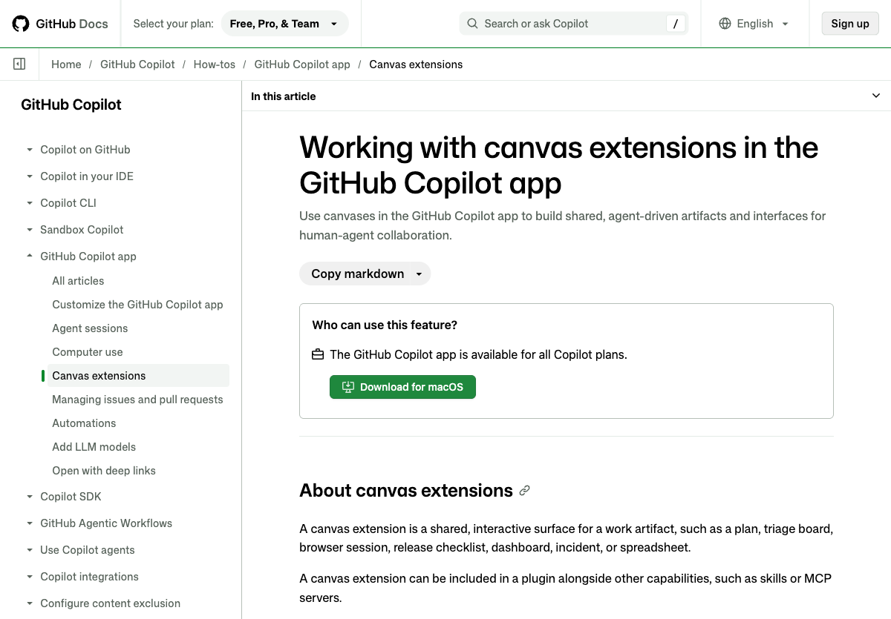

# Lab 3 — Create an ordering workflow canvas

[简体中文](https://kinfey.github.io/aigenius-ghc-app-hol/lab3/zh.html) · [Lab 2](../lab2/) · [Workshop home](../)

**Goal:** Use `/create-canvas` in Copilot App to create a shared, interactive order workflow using the Lab 2 MCP connection. Default to a dry run; a real order and payment require separate human decisions. Allow 60 minutes.

*Reference: [Working with canvas extensions](https://docs.github.com/en/copilot/how-tos/github-copilot-app/working-with-canvas-extensions). This is an App canvas, not a Power Apps canvas.*

## 1. Design the workflow

1. Open the **same local project session** and confirm `mcd-mcp` is connected as in Lab 2. Choose **Plan** and use mock products and a fictional address while developing.
2. The workflow will show **items → fulfillment/store → address (delivery only) → offers → price review → approval → payment handoff → status**. Store pickup skips address; delivery requires one. The available tools and arguments come from the live server, not from assumptions.
3. Understand the roles: the canvas is a visual shared state and agent-callable action surface; the agent discovers and invokes the separately configured MCP tools with your approval. A canvas button is not automatically an MCP call. The Lab 1 web app remains a separate application; do not assume it can access the App's MCP connection.
4. Default to **dry-run** and mock data. Never store real tokens, addresses or payment links in a shared canvas file, source code, logs or screenshots. Ask for explicit confirmation before any account-changing call. Never collect card details or automate payment.

## 2. Create and open the canvas

1. In the App composer enter `/create-canvas` followed by the prompt below. If the skill is unavailable, update the App or check **Customize → Skills**; do not substitute a different product.

   > Create a project-scoped interactive ordering workflow canvas for this repository. Use the create-canvas skill's scaffold, reload and verification workflow. Show items, fulfillment and store, delivery address only when needed, available offers, price review, approval, payment handoff and status. Provide user controls and agent-callable actions to inspect/update the same state. Default to dry-run with fictional data, persist only non-sensitive draft state in the project, and clearly label live versus mock results. The agent should use the existing mcd-mcp connection and discover tool schemas before calls; the canvas must not store or directly expose its token. Gate every account-changing action on fresh explicit user confirmation. Never auto-create an order, auto-pay, or collect payment details. Provide accessible controls, clear errors and a reset. Test actions, state persistence and both pickup and delivery.

2. Select **repository/project scope** when asked so the extension can be shared with the workshop project. Review generated files, particularly `.github/extensions/<name>/extension.mjs`; approve only commands you understand. The agent should follow the installed skill's scaffold, reload, discovery, open, action and invalid-input checks.
3. Once open in the right panel, verify the canvas and chat see the same draft. Use its controls to add a mock item, choose pickup or delivery and update a fictional address. Ask the agent to inspect the draft through its advertised action, then update it from chat and confirm the panel reflects the change.
4. Close/reopen or reload the extension and verify the non-sensitive draft survives. Switch pickup/delivery and ensure address validation is applied only to delivery. Test keyboard operation, validation, reset and visibly reported errors. If discovery or actions fail, ask the agent to inspect extension status/logs and correct the implementation.

## 3. Connect the workflow to real read-only tools

1. Ask the agent to inspect the live MCP tool list and map available tools to stages. Examples from the provider include `query-nearby-stores`, `delivery-query-addresses`, `delivery-query-stores`, `query-meals`, `query-store-coupons`, and `calculate-price`; schemas, permissions and availability can change.
2. Start with a fictional draft and read-only calls that do not require personal data. For an actual delivery address, explicitly choose whether to use your own saved address; do not request or display it in a published artifact. A store may be required before querying offers and menu.
3. Let the agent show actual menu, eligible offers, item choices and a price calculation in the canvas. Review item variants, service type, store, delivery fees, discounts and total. If unavailable, show an error or clearly labeled mock result; do not fabricate a live price. Do not assume selected discounts will apply until the service confirms them.

## 4. Approve or stop before a real order

1. For the workshop's default completion, **stop at the review screen**. A dry-run payment handoff uses a fictional link or status and makes no live `create-order` call.
2. Optional, only if you intentionally want a real order and accept the potential cost: inspect the final details, then give a **new explicit confirmation** to invoke `create-order` once. The server may return a payment link. If required information is missing or confirmation is absent, stop rather than guessing. A failed or uncertain request must not be retried automatically: query order status first to avoid duplicate orders.
3. Show the payment link only to its owner in a private context. The human opens the provider's payment page and decides whether to pay. Do not collect credentials, automatically submit payment or imply payment succeeded from link creation. If permitted, use `query-order` to check the actual status. Respect cancellation policies and require separate confirmation for cancellation.

## Evidence and completion

Capture **your own** redacted screenshots: (1) the `/create-canvas` request and resulting Copilot App panel; (2) mock pickup and delivery flows, including review and approval gates; (3) Edge showing the responsive Lab 2 offers page. Do not capture real addresses, tokens, orders or payment links. The reference image above is public documentation, not a screenshot of your finished canvas.

Finish when both fulfillment paths work in dry-run, canvas and agent share state, explicit approval gates are enforced, read-only MCP failures are visible, and no real payment occurs by default.
