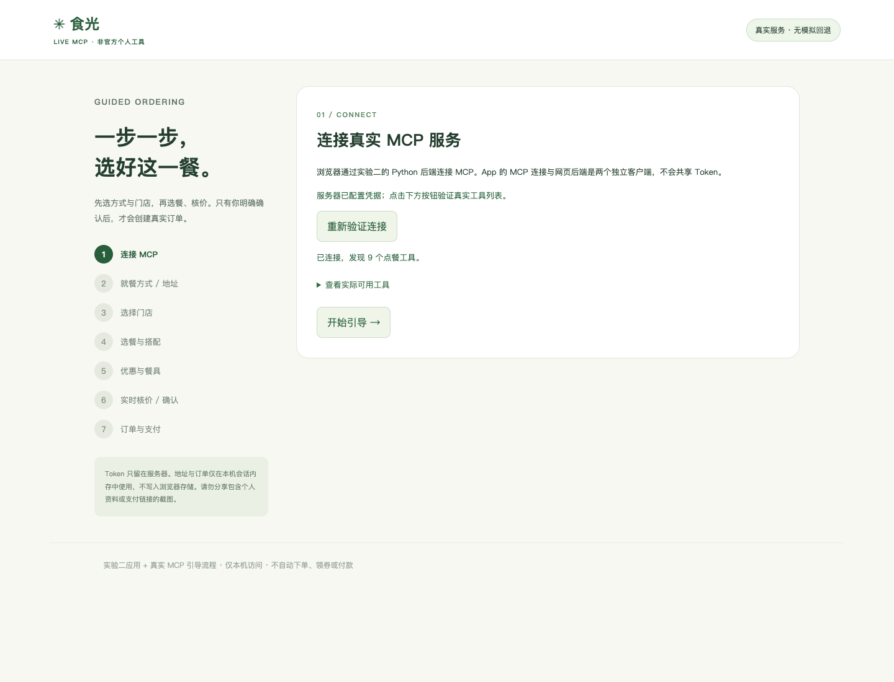
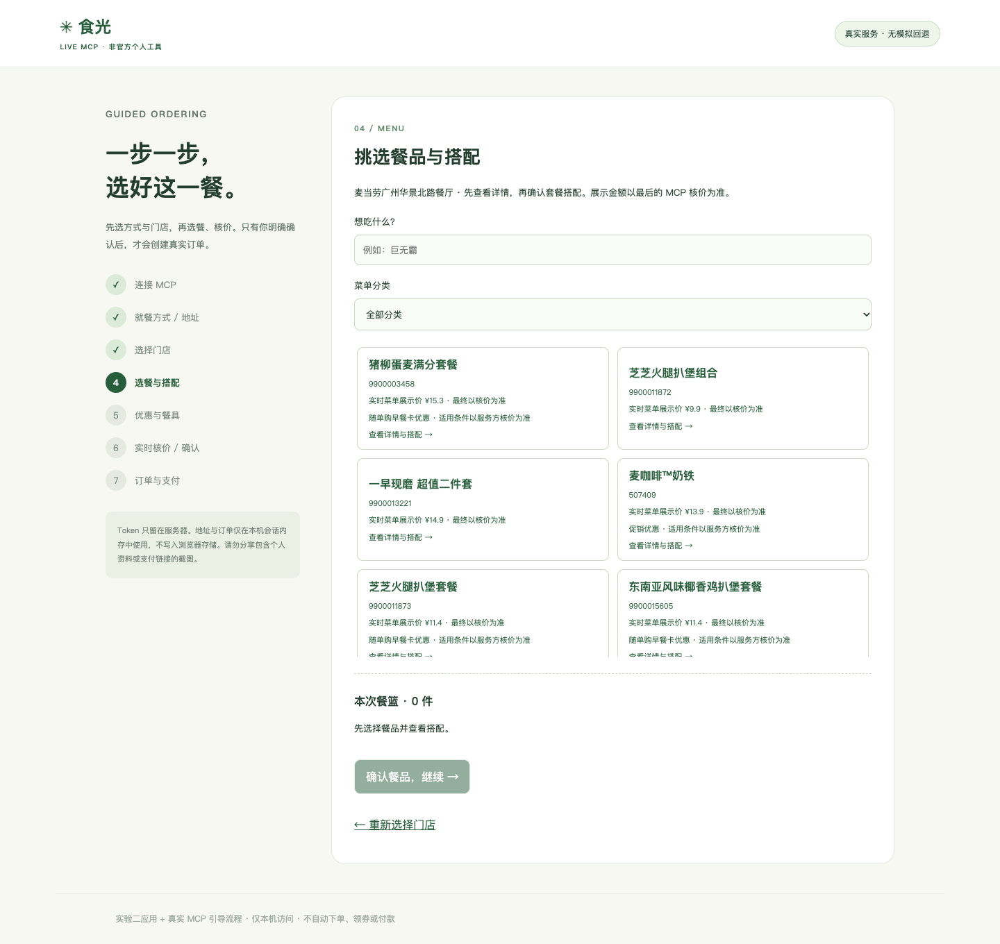
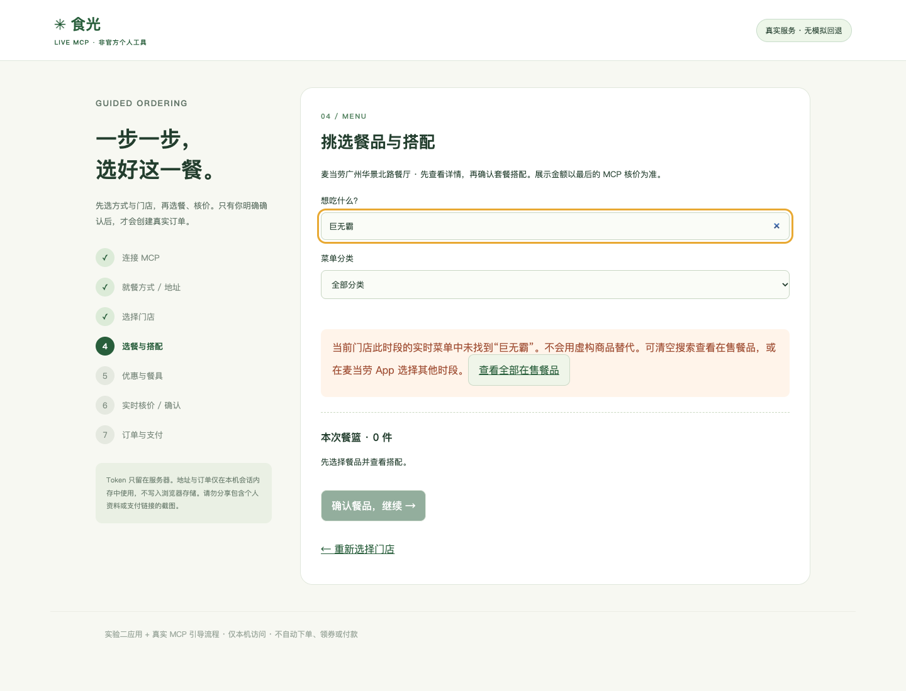
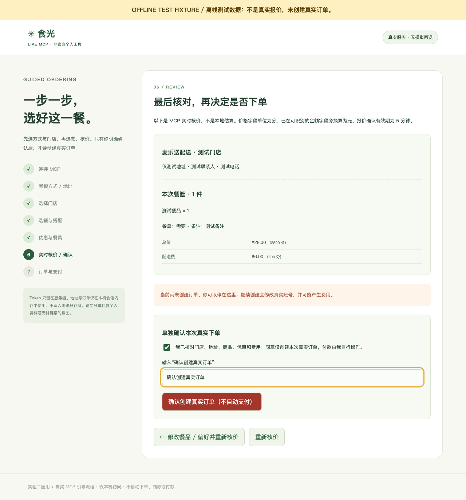
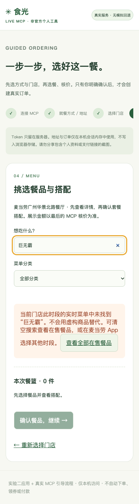

# 实验三：在画布中完成 MCP 引导式点餐

[English](https://kinfey.github.io/aigenius-ghc-app-hol/lab3/) · [繁體中文](https://kinfey.github.io/aigenius-ghc-app-hol/lab3/traditional.html) · [实验二](../lab2/zh.html) · [工作坊首页](../zh.html)

**目标：**基于实验二应用实现逐步引导的真实 MCP 点餐流程，并在 Copilot App 现有的 **Browser 画布**中打开。用时 **25 分钟**；整个课程共 **60 分钟**：实验一 20 分钟 + 实验二 15 分钟 + 实验三 25 分钟。

**已实现内容：**应用、Python MCP 适配器、引导界面、测试和截图均已提供。默认入口查询真实服务，失败时不回退为模拟商品或价格。这是 Browser 画布中的 Web 应用，**不是注册了专用 actions 的 SDK 自定义画布扩展**；Markdown 流程文档也不等于可操作应用。

**课堂停止点：**核对真实报价，不创建订单。应用另有单独确认的真实下单入口，但课程完成不要求购买或付费，支付始终由用户自行操作。

## 0. 课前准备与时间安排

安装软件、恢复依赖、登录 Copilot、激活 MCP 以及私下配置 Token 均在 60 分钟课堂之前完成。需要 Python 3.11+、Node.js 22.16+、Microsoft Edge，以及你自己的中国大陆麦当劳账户。服务与参数可能变化，以实时 schema 为准。

继续使用实验一、二的同一应用工作区。参考实现统一维护在 [`lab2/code`](https://github.com/kinfey/aigenius-ghc-app-hol/tree/main/lab2/code)，不重复创建 `lab3/code`。

| 本实验时间 | 内容 |
| --- | --- |
| 0–5 分钟 | 检查生成代码，启动应用并打开 Browser 画布 |
| 5–10 分钟 | 连接 MCP，选择就餐方式、必要的地址和门店 |
| 10–18 分钟 | 查看真实菜单，选择餐品/搭配并请求核价 |
| 18–22 分钟 | 不购买，检查确认、过期、修改与结果不确定的处理 |
| 22–25 分钟 | 执行预置检查，查看手机布局并记录结果 |

## 1. 扩展实验二应用并运行

在现有 Copilot App 项目会话中提交以下实现提示词：

> 扩展实验二的 React/TypeScript 与 Python 应用，不要另建不相连的演示。实现真实 MCP 引导式点餐：连接 → 就餐方式 → 配送时选择已有地址 → 门店 → 菜单/详情/套餐搭配 → 可用优惠/餐具/备注 → 实时核价 → 单独可选的真实下单确认 → 用户手动支付与状态查询。发现并校验实时工具 schema，不编造商品和价格，不向浏览器暴露 Token。每次真实创建必须对应新的、单次使用的报价确认；结果不确定时禁止重试。账户数据只放在本地服务器内存中。补充离线传输层和界面测试、运行命令。在现有 Browser 画布打开运行中的应用，不要只创建 Markdown 文档。

先审核生成的文件再批准执行。本仓库已包含实际生成的实现，60 分钟课堂可以直接检查和扩展，而不是从零逐行编写。

在 `lab2/code` 中于课前准备依赖：

```bash
python3 -m venv .venv
.venv/bin/python -m pip install --index-url https://packagefeedproxy.microsoft.io/pypi/simple/ -r requirements.txt
npm install
```

参考 `.env.example` 私下创建被忽略的 `.env`，限制权限（macOS/Linux 使用 `chmod 600 .env`），填入你自己的 `MCD_MCP_TOKEN`。不要贴到聊天、截图或前端代码中，也不要提交 `.env`。然后启动 API：

```bash
.venv/bin/python -m uvicorn backend.app:app --env-file .env --host 127.0.0.1 --port 8000
```

在同一目录的第二个终端运行：

```bash
npm run dev
```

让 Copilot 在现有 **Browser 画布**打开 `http://127.0.0.1:5173/`；需要时在 Edge 打开同一地址。两个服务仅监听本机回环。GitHub Pages 发布的是本教程和截图，**不承载 Python API 或带账户凭据的点餐服务**。

Copilot App 的 `mcd-mcp` 与 Python 后端是独立客户端，应用不会自动继承 App 的 Token。`OFFERS_MODE` 仅控制旧版实验二优惠接口，不控制真实点餐向导。旧模拟界面隔离在 `/?demo=1`，本实验不使用它。

## 2. 连接并选择真实门店

1. 点击「连接并发现工具」，确认真实工具列表，再点击「开始引导」。
2. 选择「到店自取」或「麦乐送配送」。到店可查询收藏门店，或填写城市和位置关键词；配送先明确点击「读取我的配送地址」，选择一个已有地址，再查询可配送门店。
3. 选择服务返回的门店并加载实际菜单，不编造门店、地址或商品 ID。如果没有已保存地址，请先在麦当劳 App 私下添加；此应用不新增地址。
4. 认证失败、服务不可用或 schema 不兼容时，检查可见错误并修正配置，不能悄悄切换到示例数据。


*同一应用在 Edge 中的实际截图，也可在 Browser 画布运行。拍摄时发现 9 个点餐工具，数量可能变化；未展示 Token 或账户资料。*

| 阶段 | 使用的 MCP 工具 |
| --- | --- |
| 到店门店 | `query-nearby-stores` |
| 配送地址与可配送门店 | `delivery-query-addresses`、`delivery-query-stores` |
| 菜单与餐品配置 | `query-meals`、`query-meal-detail` |
| 门店优惠 | `query-store-coupons` |
| 服务方核价 | `calculate-price` |
| 可选且单独确认的创建 | `create-order` |
| 实际订单状态 | `query-order` |

到店使用 `beType=1`、`orderType=1`，不传 `beCode`。配送使用 `beType=2`、`orderType=2`，并传入所选门店实际返回的 `beCode`；创建订单还需要所选 `addressId`。

## 3. 选择餐品、检查搭配并核价

1. 搜索想吃的餐品，例如「巨无霸」，或按返回的菜单分类筛选。选择实际返回的商品，查询详情。
2. 检查默认套餐搭配，选择支持的替换项和数量，再加入餐篮。当前向导使用默认特调；复杂或无法识别的配置请使用麦当劳 App。
3. 查询门店可用优惠，只有与餐品对应的服务返回优惠记录才能选择。查询不等于领券，优惠是否生效必须以核价结果为准。
4. 确认餐篮，选择是否需要餐具；配送可填写不超过 50 字的备注。点击「请求 MCP 实时核价」。
5. 核对服务返回、就餐方式、门店、配送地址、餐品和费用。菜单 `currentPrice` 字符串以元为单位；最终核价返回的数值价格/金额/费用字段以分为单位，界面同时显示元换算结果。


*服务实际返回的到店菜单，不是离线测试数据。餐品和价格随账号、门店、时间变化，截图不是优惠承诺或价格保证。*

### 练习：“我想要一个巨无霸”

记录中的早餐时段，所选配送门店返回了 **60 个真实餐品**，但没有巨无霸。正确行为是提示当前门店/时段的结果中未找到，保持餐篮不变，让用户查看在售餐品，或到官方 App 选择其他时段。不要编造巨无霸编码，也不要声称已购买。下面的截图用实际到店菜单复现了未找到的引导。


*截图反映拍摄时的实时结果，不代表所有门店、所有时段都不销售该商品。*

### 菜单解析问题与实际生成的修复

服务把分类引用和商品详情分开放置：

```text
data.categories[].meals[].code  →  data.meals[code]
```

生成代码中的 [`menu_records`](https://github.com/kinfey/aigenius-ghc-app-hol/blob/main/lab2/code/backend/ordering.py) 关联两者，保留分类和标签，并对重复商品去重。商品编码来自字典键，不要求详情值再次携带编码。映射缺失时显示错误，不拼造菜单。

```python
code = str(entry["code"])
meal = meals.get(code)
# 校验服务返回的映射后：
normalized[code] = {
    **meal,
    "productCode": code,
    "categories": [],
    "tags": [],
}
```

## 4. 核对、停止，或单独确认一次下单

课堂练习**停在价格核对页面**。使用下方离线测试演示确认界面，不要求真实购买。

只有当你自行决定购买并接受可能产生的费用时，才打开真实下单确认区、勾选确认、输入「确认创建真实订单」，最后点击创建按钮。到店还必须选择核价 `takeWayList` 返回的 `takeWayCode`。这个确认不代表授权付款。

服务器检查当前报价 ID、明确确认和 5 分钟有效期。修改订单会使报价失效；会话锁和已使用的提交状态防止双击、并发重复创建。提交失败或结果不确定后不自动重试，应先去麦当劳 App 核实，或使用已取得的订单号查询。


*顶部明确标注离线 Playwright 测试数据，其中地址、餐品和金额均为测试内容。此图只证明确认关卡的界面，不是真实报价、真实下单成功或付款成功的证据。*

如果你确实创建了真实订单，由你自行打开可识别的服务方支付链接或麦当劳 App 并决定是否付款，应用不提交支付。点击「我已支付 / 支付失败，查询实际状态」会调用 `query-order`；生成支付链接永远不等于支付成功。

## 5. 生成代码与验证

以下完整实现文件均包含在仓库中：

| `lab2/code` 下的文件 | 职责 |
| --- | --- |
| [`src/LiveOrdering.tsx`](https://github.com/kinfey/aigenius-ghc-app-hol/blob/main/lab2/code/src/LiveOrdering.tsx)、`src/live.css` | 分步向导、真实结果、菜单搜索、确认和手动支付交接 |
| `src/main.tsx` | 默认进入真实应用，旧模拟界面需要显式 `?demo=1` |
| [`backend/ordering.py`](https://github.com/kinfey/aigenius-ghc-app-hol/blob/main/lab2/code/backend/ordering.py)、`backend/app.py` | MCP 连接/schema 校验、响应整理、会话状态、报价绑定及单次创建 |
| `backend/test_ordering.py`、`backend/test_app.py` | 隔离传输层测试、就餐约束、过期、重放防护与失败处理 |
| `tests/live.spec.ts`、`tests/workflow.spec.ts`、`playwright.config.ts` | 离线浏览器/业务回归与响应式布局 |
| `scripts/capture-live.mjs` | 真实连接/菜单的安全截图；拒绝地址读取、创建订单和订单状态操作 |
| `.env.example`、`requirements.txt`、`package.json`、[`README.md`](https://github.com/kinfey/aigenius-ghc-app-hol/blob/main/lab2/code/README.md) | 私密配置示例、依赖和完整运行说明 |

在 `lab2/code` 执行：

```bash
.venv/bin/python -m unittest backend.test_app backend.test_ordering
npm run test:ui
npm run build
```

当前包含 **16 个后端测试和 17 个浏览器/业务测试**。测试用隔离数据替换真实调用，包括创建订单，不会真实下单。另外已单独核实真实连接、已有地址读取和菜单加载，均未创建订单。截图**不声称**真实核价、真实下单或支付已经成功。


*实际 Edge 手机尺寸截图。进度条在自身区域滚动，页面无横向溢出。*

复现发布截图：

```bash
# 需要已启动的本地 API/前端和私下配置的服务端凭据。
# 实际查询工具与公开位置的到店菜单，不读取地址、不下单。
node scripts/capture-live.mjs

# 完全离线测试，生成明确标注的确认关卡截图。
CAPTURE_LAB3=1 npm run test:ui -- tests/live.spec.ts -g "guided real entry"
```

真实截图脚本默认使用公开位置示例。可用 `CAPTURE_CITY` 和 `CAPTURE_KEYWORD` 换为另一个公开位置；若当前菜单变化，应调整“未找到餐品”的截图预期。发布前逐张检查，绝不截取真实地址、私人优惠券、Token、订单或支付 URL。

## 隐私、边界与完成标准

账号数据仅在本地 Python 进程中使用，通过 HttpOnly SameSite Cookie 隔离，闲置 2 小时过期。刷新可恢复同一服务端会话，重启服务器会丢失会话；重启或下单结果不确定后，应先在官方 App 核实，再考虑另建订单。不要把这个单账号教学服务暴露到不可信网络。

当前范围为即时到店/配送、已有地址、普通餐品及可识别套餐组、匹配优惠、默认特调、餐具和配送备注。预约、自定义特调、团餐/得来速、新增地址、领券、会员购买和取消订单不属于本次限时实验。

当 Browser 画布中能运行真实向导，空结果/未在售/错误都如实显示，理解菜单关联方式，预置确认测试通过，且不要求购买时，本实验完成。

**课后可选：**SDK 自定义画布扩展是另一个交付目标。在具备能力的会话中按照[官方画布扩展文档](https://docs.github.com/en/copilot/how-tos/github-copilot-app/working-with-canvas-extensions)和已安装 `/create-canvas` 技能执行 guide、scaffold、reload 与验证。不要把本 Browser 应用或 Markdown 流程图标成已注册的自定义扩展。
